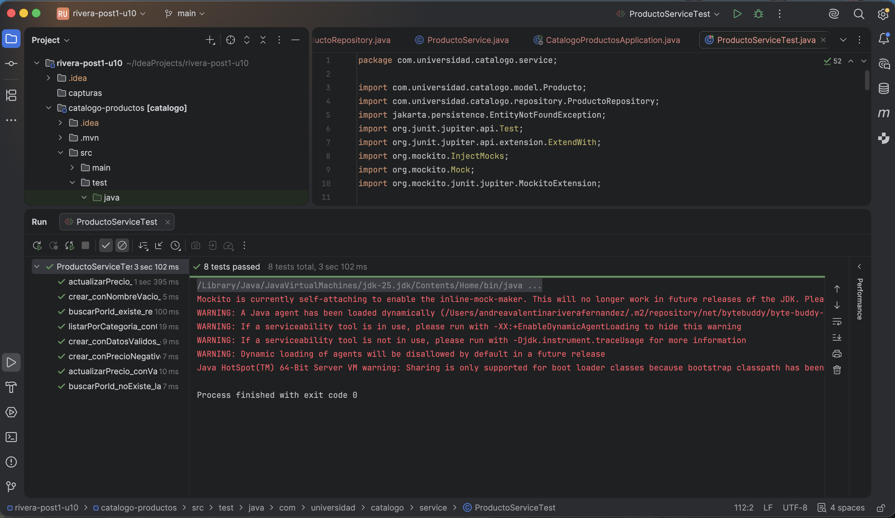
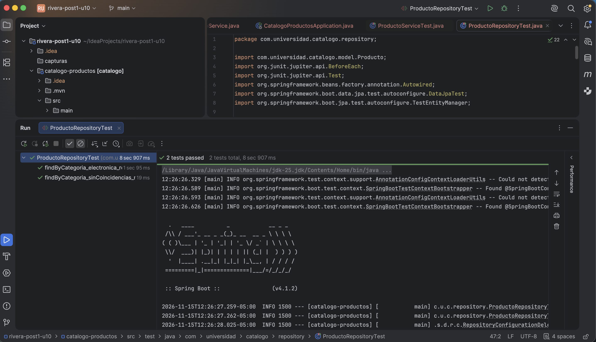
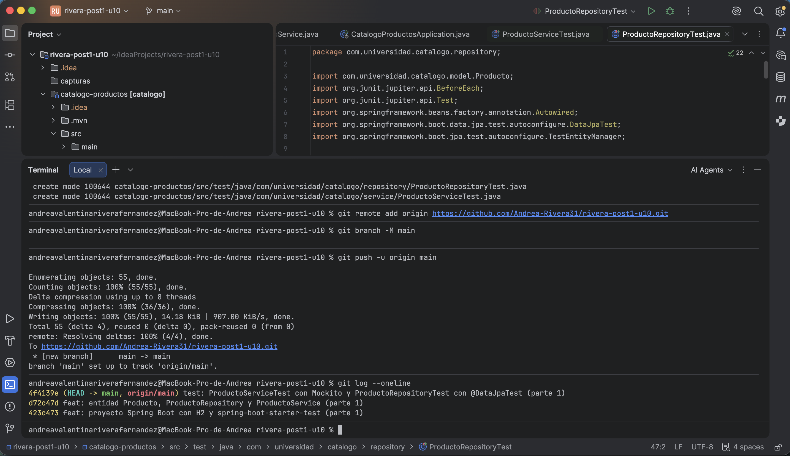
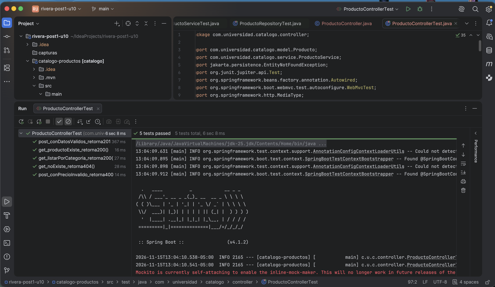
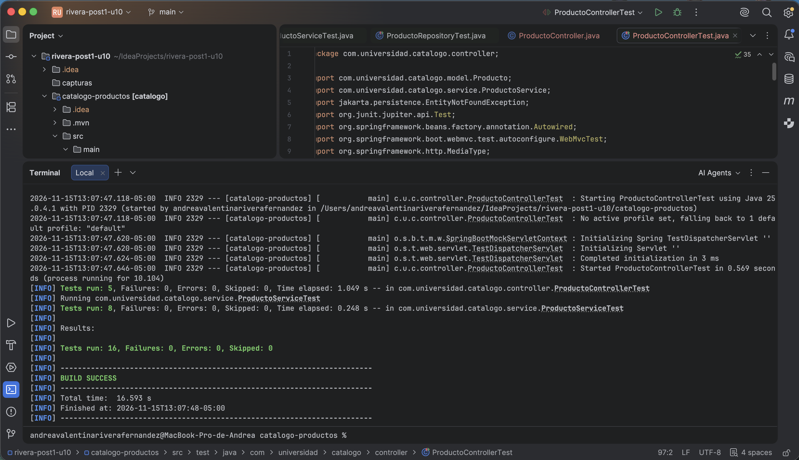
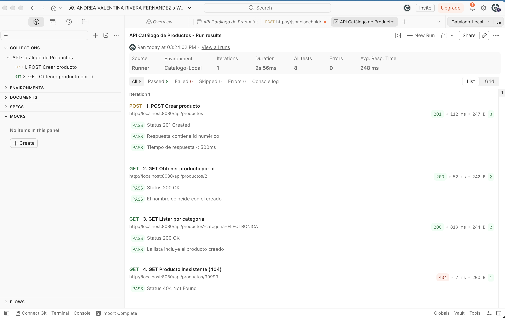
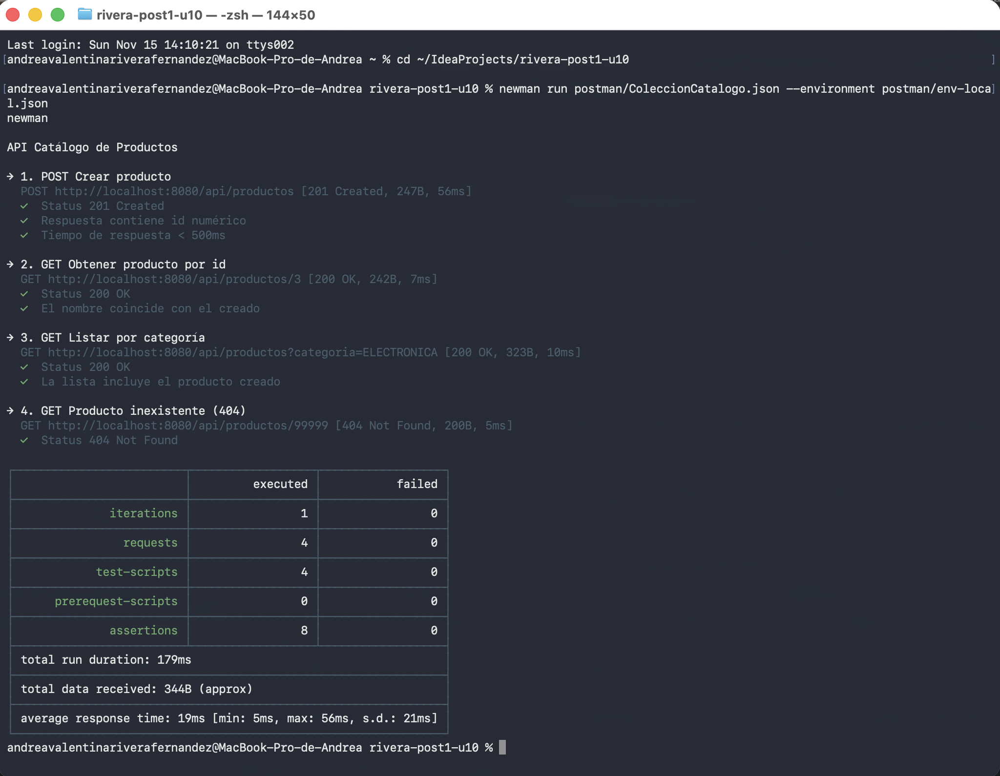
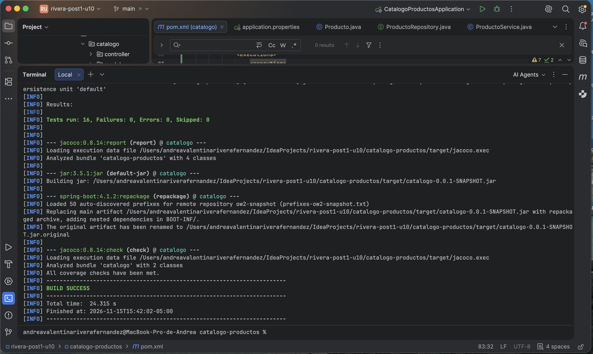
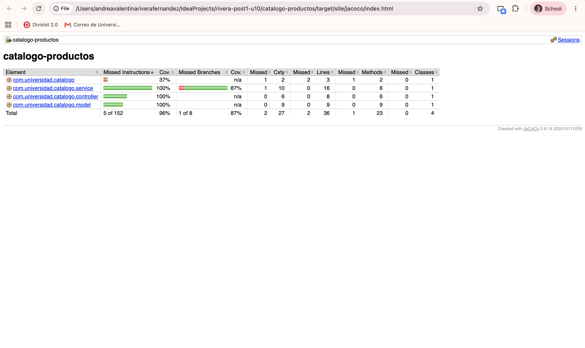
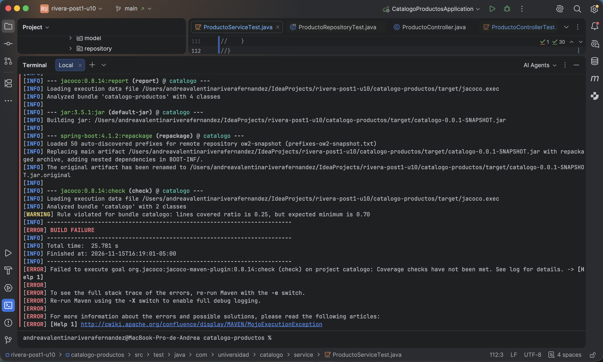

# Post-contenido — Unidad 10: Pruebas de Software en Aplicaciones Web

## Información del Estudiante
* **Nombre:** Andrea Valentina Rivera Fernández
* **Código:** 1152444
* **Institución:** Universidad Francisco de Paula Santander (UFPS)
* **Carrera:** Ingeniería de Sistemas
* **Materia:** Programación Web
* **Unidad:** 10 
* **Año:** 2026

## Descripción

Repositorio del laboratorio de la Unidad 10 de Programación Web. Contiene un
único proyecto Maven Spring Boot (`catalogo-productos/`) con una suite de
pruebas unitarias, de integración y de capa web sobre un catálogo de
productos, más una colección Postman versionada (`postman/`) y un umbral de
cobertura verificado con JaCoCo.

**Tecnologías:** Java 17, Spring Boot 4, JUnit 5, Mockito, AssertJ, H2,
MockMvc, Postman/Newman y JaCoCo.

## Orden en que se agregaron las pruebas

1. **Unitarias del servicio** (`ProductoServiceTest`): la base de la pirámide,
   rápidas y sin infraestructura.
2. **Integración del repositorio** (`ProductoRepositoryTest`): verifican las
   consultas contra una base real en memoria.
3. **Capa web** (`ProductoControllerTest`): verifican los códigos HTTP y el
   JSON sin levantar el servidor.
4. **Extremo a extremo** (colección Postman/Newman): prueban el contrato HTTP
   contra la aplicación corriendo.
5. **Cobertura** (JaCoCo): se mide al final, con las tres capas ya probadas.

## Parte 1 — Pruebas unitarias con Mockito y de integración con @DataJpaTest

- **`ProductoServiceTest`** usa `@ExtendWith(MockitoExtension.class)`,
  `@Mock` para el repositorio y `@InjectMocks` para el servicio. El
  repositorio se simula para probar solo la lógica de negocio, sin base de
  datos. Cubre el caso feliz y los casos de error (precio inválido, nombre
  vacío y producto no encontrado) con `assertThrows`, y verifica con
  `verify(repo, never()).save(any())` que el repositorio no se invoca cuando
  la validación rechaza el dato.
- **`ProductoRepositoryTest`** usa `@DataJpaTest` con `TestEntityManager` y H2
  en memoria. Carga solo la capa de persistencia y revierte los cambios entre
  tests, por lo que `setUp()` puede insertar los mismos datos cada vez.

## Parte 2 — Pruebas web, Postman/Newman y JaCoCo

- **`ProductoControllerTest`** usa `@WebMvcTest` y `MockMvc`, con el servicio
  reemplazado por `@MockitoBean`. Cubre 200, 201, 400 y 404.
- **Colección Postman** `API Catálogo de Productos`
  (`postman/ColeccionCatalogo.json`, entorno `postman/env-local.json`): 4
  requests con test scripts de status y body. Se ejecuta con el Runner o con:
  `newman run postman/ColeccionCatalogo.json --environment postman/env-local.json`
- **JaCoCo 0.8.14** con los goals `prepare-agent`, `report` y `check`: exige un
  70 % de cobertura de líneas sobre el módulo (excluye `*Application` y
  `model`) y hace fallar `mvn verify` si no se cumple.

## Decisiones de diseño

1. **H2 también para la ejecución local**, no solo para las pruebas: el
   objetivo de la unidad es la escritura de pruebas, no el modelado de
   persistencia contra un motor externo como en la Unidad 8.
2. **`buscarPorId` lanza `EntityNotFoundException`** en vez de retornar
   `null`: el contrato del método es explícito y se verifica con
   `assertThrows`, y ningún llamador tiene que recordar chequear `null`.
3. **`ProductoRepositoryTest` usa `@DataJpaTest`** en vez de `@SpringBootTest`:
   carga solo la persistencia, aísla la prueba y mantiene la suite rápida.
4. **`ProductoControllerTest` usa `@WebMvcTest`** en vez de `@SpringBootTest`
   con `TestRestTemplate`: no levanta el contexto completo ni un puerto real,
   y evita duplicar cobertura con las pruebas de servicio y repositorio.
5. **La colección Postman se versiona como `.json`**, no como test JUnit:
   prueba el contrato HTTP como caja negra contra un proceso real, un nivel
   distinto y complementario al de MockMvc.
6. **JaCoCo se configura al cierre de la Parte 2**, no de la Parte 1: medir la
   cobertura con la suite incompleta daría una falsa sensación de cumplir el
   70 %. Se midió con las tres capas probadas y se comprobó que el build falla
   al quitar pruebas.
7. **Este laboratorio no incluye Selenium WebDriver.** El catálogo es una API
   REST pura, sin vista Thymeleaf. Fabricar una vista solo para justificar
   Selenium introduciría una capa de presentación ficticia y contradiría la
   pirámide de pruebas: las pruebas de extremo a extremo se reservan para
   flujos de usuario reales sobre una interfaz real. En un proyecto con
   formularios Thymeleaf, Selenium con Page Object Model sí sería la
   herramienta correcta. Aquí, la colección Postman cumple el rol de prueba de
   extremo a extremo sobre la superficie que expone la aplicación.

### Notas técnicas de Spring Boot 4

- Se usa `@MockitoBean` en lugar de `@MockBean`, eliminado en Spring Boot 4.
- Las anotaciones `@WebMvcTest` y `@DataJpaTest` y `TestEntityManager` viven
  en paquetes nuevos (`org.springframework.boot.webmvc.test.autoconfigure`,
  `...data.jpa.test.autoconfigure` y `...jpa.test.autoconfigure`).
- El cuerpo JSON de las pruebas web se escribe como texto para no depender del
  cambio de paquete de `ObjectMapper` (Jackson 3).
- Se usa JaCoCo 0.8.14 por compatibilidad con el JDK 25 de desarrollo.

## Prerrequisitos

- JDK 17 o superior y Maven (wrapper `mvnw` incluido)
- Node.js 18+ y Newman (`npm install -g newman`)
- Postman Desktop (opcional, para el Runner)

## Cómo compilar y ejecutar

1. Clonar: `git clone https://github.com/Andrea-Rivera31/rivera-post1-u10.git`
2. Entrar al proyecto: `cd rivera-post1-u10/catalogo-productos`
3. Ejecutar la aplicación: `./mvnw spring-boot:run`
4. Ejecutar la suite con verificación de cobertura:
   `./mvnw clean verify` (el reporte queda en `target/site/jacoco/index.html`
   y el build falla si la cobertura es menor al 70 %)
5. Con la aplicación en ejecución, desde la raíz del repositorio:
   `newman run postman/ColeccionCatalogo.json --environment postman/env-local.json`

## Capturas de pantalla

### Parte 1

Tests unitarios del servicio con Mockito:

Tests de integración del repositorio con @DataJpaTest:

Historial de commits de la Parte 1:

### Parte 2

Tests de la capa web con @WebMvcTest:

Toda la suite (unitarias, integración y web) en verde:

Postman Runner con 0 failures:

Misma colección con Newman:

`mvn clean verify` en verde con la cobertura cumplida:

Reporte de cobertura JaCoCo (≥ 70 %):

Build fallando por cobertura insuficiente (evidencia del gate):

